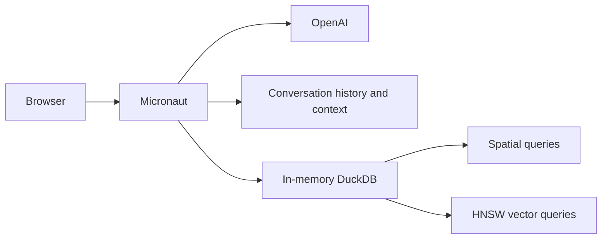

# Swiss Travel Advisor

A Java 25 travel assistant built with Micronaut 5, LangChain4j, OpenAI, and an embedded in-memory DuckDB database. Chat about Swiss destinations, hotels, and activities, search nearby places, and save a wishlist for each conversation.



## Build and run

Install JDK 25. From `clients/java`, build this example and the memory client together:

```bash
mvn -pl examples/langchain4j-travel-advisor -am clean package -DskipTests
```

Then change to `examples/langchain4j-travel-advisor` and configure both services:

```bash
export OPENAI_API_KEY='<openai-api-key>'
export NAMS_API_KEY='<workspace-bound-key>'
export NAMS_BASE_URL='https://memory.neo4jlabs.com/v1'
java -jar target/langchain4j-travel-advisor-*.jar
```

Open [http://localhost:8080](http://localhost:8080). Development can also use `./mvnw mn:run`.

The first startup downloads and caches DuckDB's Spatial and VSS extensions, so it needs network access. Every startup seeds 7 destinations, 12 hotels, and 9 activities, makes 28 embedding API calls using `text-embedding-3-small` by default, validates the embeddings, and builds three cosine HNSW indexes before startup completes. Embedding calls incur API usage. Startup fails if extension setup, embedding generation, or indexing fails. If you set `OPENAI_BASE_URL` and `OPENAI_EMBEDDING_MODEL` for a compatible provider, its embedding model must support a 1536-dimension request; the database and search indexes use that fixed size.

The application owns one named, pinned in-memory database. All connections share it, and shutdown releases it. Restart reseeds the catalog and regenerates embeddings. Conversation history survives app restarts; wishlists reset when the app restarts. NAMS stores conversation history and context remotely; DuckDB requires no database credentials.

## Logging

`TravelAdvisorChatModelLogger` logs the number of messages and counts by type for
every model request at INFO, alongside the latest user/tool/assistant summaries.
For example, a system prompt containing remembered context and a new user message
produce `[ai] request: 2 messages {SYSTEM=1, USER=1}`.

To inspect the complete model input, add this logger inside `<configuration>` in
`src/main/resources/logback.xml` and restart the application:

```xml
<logger name="com.example.logging.TravelAdvisorChatModelLogger" level="DEBUG"/>
```

DEBUG logs every request message in order, with its index, type, and full content,
including the system prompt, conversation history, and live tool exchanges. These
entries also appear for tool follow-up requests and are not truncated to the
280-character limit used by the INFO summaries. This includes full conversation
text, so enable DEBUG only when that content belongs in your logs.

NAMS conversation context supplies recent messages, observations, and reflections
through `NAMS_CONTEXT_JSON` in the system prompt. The adapter reads context once per
model invocation, with no separate history read. Context messages are deduplicated
by native UUID and exclude text already represented by the active turn. When no
remembered information remains, the application prompt and live turn are used alone.

The agent-memory client uses JDK `System.Logger`. Following its [logging guide](https://github.com/kubamarchwicki/agent-memory-tck/blob/a5d7c925b4f22d0b6455013a290badcd71d44074/clients/java/README.md#blocking-helper-and-logging), the runtime dependency `slf4j-jdk-platform-logging` routes these events to the application's existing Logback console appender. Its version matches the Micronaut platform's managed `slf4j-api` version.

`src/main/resources/logback.xml` explicitly enables `org.neo4j.agentmemory.AwaitSupport` at INFO, including when the root level is raised to WARN. The client's default-timeout fallback logs once, at INFO for an absent or blank `NAMS_AWAIT_TIMEOUT_SECONDS`, or WARN for an invalid value. Application calls pass the explicit `nams.wait-timeout` duration, so they do not emit this fallback event.

## Search and conversations

Unfiltered searches use cosine HNSW indexes to return up to five results. Destination, price, and geographic filters select rows first, then exact cosine ranking returns the best five matches. Spatial distances are in metres, with longitude/latitude axis order configured on every pooled connection.

Nearby searches resolve names against Zermatt, Interlaken, Lucerne, Lausanne, St. Moritz, Lugano, and Zurich. Query embeddings are generated on demand. LangChain4j selects the search and wishlist tools and assembles NAMS context with the active turn for each UUID conversation. Wishlists are associated with that same conversation ID.

```bash
curl -s http://localhost:8080/api/chat \
  -H 'Content-Type: application/json' \
  -d '{"message":"Recommend a peaceful Swiss mountain destination"}'
```

Reuse the returned `conversationId` in subsequent chat requests to continue that conversation. `GET /api/conversations`, `GET /api/conversations/{id}`, and `GET /api/wishlist?conversationId={id}` expose its stored state during this application run. Ask the assistant to save a suggested item to its wishlist.

## Verification

```bash
./mvnw clean test
```

Client artifact verification, including contract and hosted integration checks, belongs to the `memory-client` JAR build process. This application consumes the resulting artifact and runs its application tests.

Tests use real DuckDB databases and deterministic embedding stubs. The startup test uses the runtime datasource and Flyway versions and verifies seeding, HNSW indexes, pooled geographic calculations, repository queries, HTTP reads, and state reset across application contexts. Tests do not require an OpenAI key; first-time extension installation still needs network access.

## Conversation persistence and deployment

NAMS stores conversation history, observations, reflections, and recorded tool
activity. LangChain4j ChatMemory assembles NAMS conversation context and the active
turn for the model. Past tool activity is remembered through observations and
reflections; historical tool requests and results are never loaded into ChatMemory.

The current turn temporarily retains its live tool requests and results so the
model can continue that turn. They are recorded with native reasoning steps/tool
calls and discarded when the turn finishes or fails.

NAMS selects the recent messages returned in conversation context. The former
`nams.recent-message-limit` setting has been removed. The adapter does not impose a
total prompt or token limit.

Conversation history survives restarts; wishlists reset on restart. Native writes
are not automatically retried, and partial writes or tool side effects can remain
after a failed turn. The native client JAR must already be in the Maven repository;
client build and hosted verification belong to its own build process.

NAMS assigns the conversation UUID used by chat, sidebar/detail responses, tools, and local wishlist rows. Saved user/assistant text is append-only. Catalog data and embeddings are rebuilt locally.

See the [conversation glossary](CONTEXT.md), [ownership ADR](docs/adr/0001-nams-memory-ownership.md), and [implementation plan](docs/plans/0005-stateless-nams-memory-provider.md). The provider creates adapters without retaining a conversation list. LangChain4j retains the adapter during an HTTP turn, and the controller releases that reference on return or failure. Each later turn loads its conversation from NAMS; releasing an adapter never deletes the conversation.

The assistant is registered by a singleton factory using Micronaut's existing AI-service builder. This preserves the configured model, tools, memory provider, optional retrieval, and customizers while keeping inherited lifecycle accessors on the same LangChain4j service as chat.

`NAMS_API_KEY` is a workspace-bound key; `NAMS_BASE_URL` must include the runtime `/v1` endpoint. Supply secrets through environment configuration, never tracked files. If a deployment secret is named `MEMORY_API_KEY`, map it to `NAMS_API_KEY` in the process environment. Rotate keys by updating configuration and restarting while retaining the same workspace.

Maven resolves the client JAR as a required dependency and fails dependency resolution if it is unavailable. The application build does not build or install the client; its build and verification are handled by the `memory-client` project.

For initial cutover, provision a fresh dedicated NAMS workspace and configure its key. Existing DuckDB conversation IDs and wishlists are discarded, not imported; old IDs return 404. Keep that workspace across subsequent restarts. Verify chat, sidebar/detail, and wishlist association before and after restarting the packaged JAR. Wishlist state resets while conversation identity/title/text remain.

Rollback runs the prior build with empty local DuckDB state. Leave the NAMS workspace untouched so a later return to this build can reuse it. Startup/shutdown never delete remote conversations. Application tests use fake services to check restart and cutover behavior.

Service outages return errors rather than empty successful history: upstream failures map to 502 and bounded wait expiry to 504; unknown conversations return 404. Native writes have no automatic retry. A failed turn discards its temporary tool state; a later user retry can save duplicate text if the first write reached the service. Empty native context is valid, but an unavailable or invalid context response fails the request.
