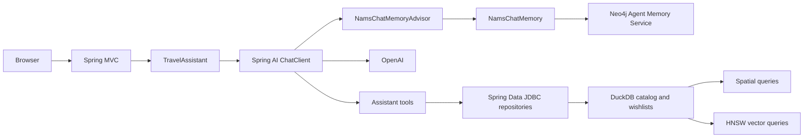

# Swiss Travel Advisor

A Java 25 travel assistant built with Spring Boot, Spring AI, OpenAI, Spring Data JDBC, and embedded in-memory DuckDB. Chat about Swiss destinations, hotels, and activities, search nearby places, and save a wishlist for each conversation.



## Build and run

Install JDK 25 and set your OpenAI API key:

```bash
export OPENAI_API_KEY='<openai-api-key>'
export NAMS_API_KEY='<nams-api-key>'
./mvnw clean package
java -jar target/swiss-travel-advisor-0.1.jar
```

Open [http://localhost:8080](http://localhost:8080) for the browser UI. For development, `./mvnw spring-boot:run` starts the same application.

The first startup downloads and caches DuckDB's Spatial and VSS extensions, so it needs network access. Every startup seeds 7 destinations, 12 hotels, and 9 activities, makes 28 embedding API calls using `text-embedding-3-small` by default, validates the embeddings, and builds three cosine HNSW indexes before startup completes. Embedding calls incur API usage. Startup fails if extension setup, embedding generation, or indexing fails. If you set `OPENAI_BASE_URL` and `OPENAI_EMBEDDING_MODEL` for a compatible provider, its embedding model must support a 1536-dimension request; the database and search indexes use that fixed size.

The application owns one named, pinned in-memory database. All connections share it, and shutdown releases it. Restart reseeds the catalog and regenerates embeddings; wishlists reset while conversations persist remotely in NAMS. No database server or database credentials are required.

## Search and conversations

Unfiltered searches use cosine HNSW indexes to return up to five results. Destination, price, and geographic filters select rows first, then exact cosine ranking returns the best five matches. Spatial distances are in metres, with longitude/latitude axis order configured on every pooled connection.

Nearby searches resolve names against Zermatt, Interlaken, Lucerne, Lausanne, St. Moritz, Lugano, and Zurich. Query embeddings are generated on demand. Spring AI selects the search and wishlist tools. NAMS supplies conversation UUIDs and complete native recall; the browser displays the latest 20 messages in chronological order. Wishlists are associated with that same conversation ID. The assistant saves a wishlist item only when asked explicitly.

```bash
curl -s http://localhost:8080/api/chat \
  -H 'Content-Type: application/json' \
  -d '{"message":"Recommend a peaceful Swiss mountain destination"}'
```

Reuse the returned `conversationId` in subsequent chat requests to continue that conversation. `GET /api/conversations`, `GET /api/conversations/{id}`, and `GET /api/wishlist?conversationId={id}` expose remote conversation history and the current local wishlist. Ask the assistant to save a suggested item to its wishlist.

## Operational logging

Operational AI logs are enabled by default, including user turns, tool calls and results, assistant token counts, and model error types. Set `AI_LOGGING_INCLUDE_CONTENT=false` to hide message and tool content, or `app.ai.pretty-logging.enabled=false` to disable these logs.

## Verification

```bash
./mvnw clean verify
```

Tests use real DuckDB databases and deterministic embedding stubs. The startup test uses the runtime datasource and Flyway versions and verifies seeding, HNSW indexes, pooled geographic calculations, repository queries, HTTP reads, and state reset across application contexts. Tests do not require an OpenAI key; first-time extension installation still needs network access.

## NAMS client setup and memory behavior

This application uses the locally installed `org.neo4j:agent-memory-client:0.1.0-SNAPSHOT` with `MemoryClientConfiguration` and Spring `RestClient` support, conversation types in `org.neo4j.agentmemory.conversation`, reasoning types in `org.neo4j.agentmemory.reasoning`, and exceptions in `org.neo4j.agentmemory.exception`. Earlier snapshots without the configuration builder or Spring adapter are incompatible. On a fresh machine, install JDK 25 and Maven, clone the client sources and install the updated module before building the application:

```bash
git clone https://github.com/kubamarchwicki/agent-memory-tck.git
cd agent-memory-tck
git checkout 1b6d3e036c85e1e52790f8130cf32ee42b926902
mvn -f clients/java/pom.xml -pl memory-client -am clean install
```

`NamsConfiguration` builds the memory client with Boot's auto-configured `RestClient.Builder` and managed `applicationTaskExecutor`. The `spring-boot-starter-restclient` dependency enables Boot's default HTTP configuration, including request factory selection and HTTP client customizers, SSL settings, and observations. Blocking memory exchanges run on the application executor. See the [client's Spring integration documentation](https://github.com/kubamarchwicki/agent-memory-tck/blob/1b6d3e036c85e1e52790f8130cf32ee42b926902/clients/java/README.md#using-a-spring-restclient).

Return to this application's directory for its build/run commands. `NAMS_API_KEY` is required. Optional `NAMS_BASE_URL` defaults to `https://memory.neo4jlabs.com/v1`; optional `NAMS_TIMEOUT` defaults to `10s`. The timeout applies to each required native wait and each background completion stage, not the whole model turn. Each new turn recalls native reflections, observations and recent messages. Reflections and observations become literal context; native message roles and chronological order are preserved. User text, intermediate assistant text and the selected final answer are appended synchronously and acknowledged before proceeding. Required recall or text-write failures fail the request; `ChatMemory.clear` is unsupported.

`NamsChatMemoryAdvisor` wraps the complete tool loop on the configured `ChatClient`. It reads `ChatMemory.CONVERSATION_ID` from advisor context, loads context through `NamsChatMemory`, inserts it after the prompt's leading system messages, and records the current user before model execution. After the tool loop finishes, it validates and records only the selected final answer. `TravelAssistant` supplies the travel prompt and conversation/tool context. The advisor supports synchronous calls; streaming is rejected before memory or model work.

Spring AI owns the tool loop and its temporary protocol history. Each execution round collects actual attempts into one native reasoning step, including successes and failures from a partial round. Repeated same-name calls are separate children; requested tools that never execute have no record. Tool evidence is recorded asynchronously through the native client after round execution. The HTTP response can complete while recording is still pending. Lookup or step failure prevents dependent writes; failed children do not suppress their siblings. Recording failures are logged and preserve tool results and exceptions, so reasoning data has eventual visibility and may be lost on shutdown. A timed-out in-flight write can still complete remotely. There are no application retries, rollback, cancellation, shutdown drain or exactly-once guarantees.

The local tests use loopback NAMS/model endpoints and the real client, including persisted-text recall across two JVMs while wishlists reset. They require no OpenAI or NAMS credentials. Hosted NAMS contract verification has not been run. Existing operational logging and Boot OpenTelemetry remain; no restored custom observability is claimed. See [the investigation](docs/reviews/0004-nams-spring-ai-investigation.md) for synchronized artifact evidence and verification limits.
